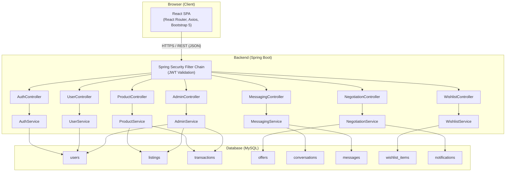
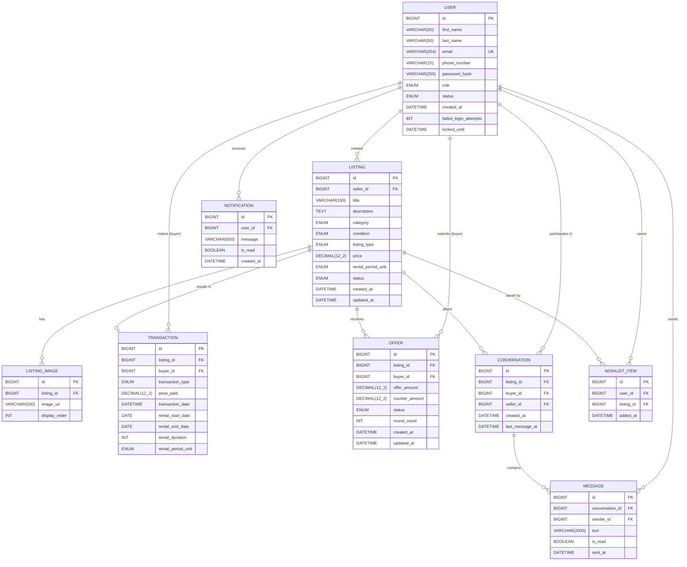

# Design Document

## Overview

ReVendo is a peer-to-peer (P2P) marketplace web application that allows users to buy, sell, and rent pre-owned goods across five categories: Electronics, Furniture, Books, Home Appliances, and Household Goods. The system connects individual buyers and sellers through product listings, a real-time-like messaging system, a price negotiation workflow, wishlists, and personal dashboards.

The application follows a classic **client-server architecture**:

- A **React.js** single-page application (SPA) runs in the browser and handles all user interaction, routing, and API communication.
- A **Java Spring Boot** REST API serves as the backend, handling all business logic, data persistence, and security enforcement.
- A **MySQL** relational database persists all application data.
- **Spring Security + JWT** provides stateless, token-based authentication across all protected endpoints.

### Design Goals

- **Separation of concerns**: Each backend service owns one bounded domain (auth, products, negotiations, messaging, wishlists, users, admin).
- **Stateless authentication**: JWTs are issued on login, stored client-side, and validated on every request — no server-side sessions.
- **Secure by default**: Every endpoint that modifies or reads private data requires a valid JWT; admin-only endpoints additionally require `ROLE_ADMIN`.
- **Responsive UI**: The frontend uses Bootstrap 5 with custom CSS properties to deliver a consistent experience from 320 px mobile to 1200 px desktop.

---

## Architecture

### High-Level System Diagram



### Request Lifecycle

1. The React SPA makes an HTTP request via **Axios**. An Axios request interceptor automatically attaches the JWT from `localStorage` as a `Bearer` token in the `Authorization` header (if present).
2. The request hits the **Spring Security Filter Chain**. A custom `JwtAuthenticationFilter` extracts and validates the token. Public routes bypass this filter.
3. The request is dispatched to the appropriate **Controller**, which delegates business logic to a **Service**.
4. The Service interacts with the database through **Spring Data JPA Repositories**.
5. The response is serialised to JSON and returned to the React SPA.
6. An Axios response interceptor handles `401` responses by clearing the stored JWT and redirecting to the login page.

---

## Components and Interfaces

### Backend Layer

#### Controller → Service → Repository pattern

Each domain follows the same three-layer structure:

```
Controller  (HTTP request/response mapping, input validation via @Valid)
    ↓
Service     (business logic, transaction management)
    ↓
Repository  (Spring Data JPA interface, SQL queries)
```

#### Spring Boot Project Structure

```
com.revendo
├── config
│   ├── SecurityConfig.java          # Spring Security bean definitions, CORS, public/protected routes
│   └── JwtConfig.java               # JWT secret, expiry constants
├── security
│   ├── JwtTokenProvider.java        # generate, validate, parse JWT
│   └── JwtAuthenticationFilter.java # OncePerRequestFilter — extracts JWT, sets SecurityContext
├── controller
│   ├── AuthController.java
│   ├── ProductController.java
│   ├── NegotiationController.java
│   ├── MessagingController.java
│   ├── WishlistController.java
│   ├── UserController.java
│   └── AdminController.java
├── service
│   ├── AuthService.java
│   ├── ProductService.java
│   ├── NegotiationService.java
│   ├── MessagingService.java
│   ├── WishlistService.java
│   ├── UserService.java
│   └── AdminService.java
├── repository
│   ├── UserRepository.java
│   ├── ListingRepository.java
│   ├── TransactionRepository.java
│   ├── OfferRepository.java
│   ├── ConversationRepository.java
│   ├── MessageRepository.java
│   ├── WishlistItemRepository.java
│   └── NotificationRepository.java
├── model (JPA Entities)
│   ├── User.java
│   ├── Listing.java
│   ├── Transaction.java
│   ├── Offer.java
│   ├── Conversation.java
│   ├── Message.java
│   ├── WishlistItem.java
│   └── Notification.java
├── dto (Data Transfer Objects)
│   ├── request/   # incoming payloads (LoginRequest, RegisterRequest, CreateListingRequest, …)
│   └── response/  # outgoing payloads (AuthResponse, ListingResponse, OfferResponse, …)
└── exception
    ├── GlobalExceptionHandler.java   # @ControllerAdvice, maps exceptions → HTTP status codes
    ├── ResourceNotFoundException.java
    ├── UnauthorizedException.java
    └── ValidationException.java
```

### Frontend Layer

#### React Project Structure

```
src/
├── api/
│   └── axiosInstance.js         # configured Axios instance with request/response interceptors
├── components/
│   ├── common/
│   │   ├── Navbar.jsx            # responsive nav bar, auth-aware
│   │   ├── Footer.jsx
│   │   ├── ProductCard.jsx       # reusable listing card
│   │   ├── LoadingSpinner.jsx
│   │   ├── ToastNotification.jsx # auto-dismiss 4 s toast
│   │   ├── ConfirmDialog.jsx
│   │   └── Pagination.jsx
│   ├── auth/
│   │   ├── ProtectedRoute.jsx    # redirects unauthenticated users to /login
│   │   └── AdminRoute.jsx        # additionally checks ROLE_ADMIN
│   └── listings/
│       ├── ImageCarousel.jsx
│       ├── FilterPanel.jsx
│       └── ImageUploader.jsx
├── pages/
│   ├── HomePage.jsx
│   ├── LoginPage.jsx
│   ├── RegisterPage.jsx
│   ├── ProductListingPage.jsx
│   ├── ProductDetailsPage.jsx
│   ├── CreateListingPage.jsx
│   ├── EditListingPage.jsx
│   ├── MessagesPage.jsx
│   ├── ConversationPage.jsx
│   ├── WishlistPage.jsx
│   ├── UserDashboardPage.jsx
│   ├── AdminDashboardPage.jsx
│   └── NotFoundPage.jsx
├── context/
│   └── AuthContext.jsx           # React Context providing currentUser, login(), logout()
├── hooks/
│   ├── useAuth.js                # consumes AuthContext
│   └── useToast.js               # exposes showToast() helper
├── services/                     # thin wrappers around axiosInstance calls
│   ├── authService.js
│   ├── productService.js
│   ├── negotiationService.js
│   ├── messagingService.js
│   ├── wishlistService.js
│   ├── userService.js
│   └── adminService.js
├── utils/
│   ├── validators.js             # client-side validation helpers
│   └── formatters.js            # currency, date, truncation helpers
├── App.jsx                       # React Router route definitions
└── main.jsx                      # ReactDOM.createRoot entry point
```

#### Frontend Routing Table

| Route | Component | Auth Required | Role |
|---|---|---|---|
| `/` | `HomePage` | No | — |
| `/login` | `LoginPage` | No | — |
| `/register` | `RegisterPage` | No | — |
| `/products` | `ProductListingPage` | No | — |
| `/products/:id` | `ProductDetailsPage` | No | — |
| `/sell` | `CreateListingPage` | Yes | USER |
| `/listings/:id/edit` | `EditListingPage` | Yes | USER (owner) |
| `/messages` | `MessagesPage` | Yes | USER |
| `/messages/:conversationId` | `ConversationPage` | Yes | USER |
| `/wishlist` | `WishlistPage` | Yes | USER |
| `/dashboard` | `UserDashboardPage` | Yes | USER |
| `/admin` | `AdminDashboardPage` | Yes | ADMIN |
| `*` | `NotFoundPage` | No | — |

### Backend API Design

All endpoints are prefixed with `/api`. JSON is the only accepted/returned content type.

#### Authentication Endpoints (`/api/auth`)

| Method | Path | Auth | Description |
|---|---|---|---|
| `POST` | `/api/auth/register` | Public | Register a new user |
| `POST` | `/api/auth/login` | Public | Authenticate and receive JWT |

**POST /api/auth/register**
```json
// Request
{
  "firstName": "Jane",
  "lastName": "Doe",
  "email": "jane@example.com",
  "phoneNumber": "12345678",
  "password": "securePass1",
  "confirmPassword": "securePass1"
}
// Response 201
{ "message": "Account created successfully. Please log in." }
// Response 400
{ "error": "Email address is already in use." }
```

**POST /api/auth/login**
```json
// Request
{ "email": "jane@example.com", "password": "securePass1" }
// Response 200
{ "token": "<JWT>", "role": "ROLE_USER", "userId": 1, "displayName": "Jane Doe" }
// Response 401
{ "error": "Invalid credentials." }
// Response 403 (suspended)
{ "error": "This account has been suspended." }
// Response 429 (locked)
{ "error": "Account temporarily locked. Try again in 15 minutes." }
```

#### Product Endpoints (`/api/products`)

| Method | Path | Auth | Description |
|---|---|---|---|
| `GET` | `/api/products` | Public | Paginated list with search/filter/sort |
| `GET` | `/api/products/:id` | Public | Single listing details |
| `POST` | `/api/products` | USER | Create a listing |
| `PUT` | `/api/products/:id` | USER (owner) | Update a listing |
| `DELETE` | `/api/products/:id` | USER (owner) | Delete (soft) a listing |

**GET /api/products — Query Parameters**

| Param | Type | Description |
|---|---|---|
| `page` | int (default 0) | Zero-based page index |
| `size` | int (default 12, max 12) | Page size |
| `keyword` | string | Search in title/description |
| `category` | string | Electronics \| Furniture \| Books \| Home Appliances \| Household Goods |
| `condition` | string | New \| Like New \| Good \| Fair \| Poor |
| `listingType` | string | FOR_SALE \| FOR_RENT |
| `minPrice` | decimal | Minimum price (≥ 0) |
| `maxPrice` | decimal | Maximum price |
| `sort` | string | PRICE_ASC \| PRICE_DESC \| NEWEST |

```json
// Response 200
{
  "content": [
    {
      "id": 1,
      "title": "iPhone 13",
      "price": 450.00,
      "category": "Electronics",
      "condition": "Good",
      "listingType": "FOR_SALE",
      "status": "Active",
      "imageUrls": ["url1"],
      "sellerDisplayName": "Jane Doe",
      "createdAt": "2024-01-15T10:30:00Z"
    }
  ],
  "totalElements": 48,
  "totalPages": 4,
  "currentPage": 0
}
```

**POST /api/products** (multipart/form-data)
- Fields: `title`, `description`, `category`, `condition`, `listingType`, `price`, `rentalPeriodUnit` (optional), `images` (1–5 files)
```json
// Response 201
{ "id": 42, "title": "...", "status": "Active", ... }
// Response 400
{ "errors": { "title": "Title is required.", "images": "At least one image is required." } }
```

#### Negotiation Endpoints (`/api/negotiations`)

| Method | Path | Auth | Description |
|---|---|---|---|
| `POST` | `/api/negotiations` | USER | Submit an offer |
| `GET` | `/api/negotiations/listing/:listingId` | USER | Get offers for a listing (seller view) |
| `GET` | `/api/negotiations/my-offers` | USER | Get buyer's own offers |
| `PUT` | `/api/negotiations/:offerId/accept` | USER (seller/buyer) | Accept offer or counter-offer |
| `PUT` | `/api/negotiations/:offerId/reject` | USER (seller/buyer) | Reject offer or counter-offer |
| `PUT` | `/api/negotiations/:offerId/counter` | USER (seller) | Submit counter offer |

**POST /api/negotiations**
```json
// Request
{ "listingId": 42, "offerAmount": 380.00 }
// Response 201
{ "offerId": 7, "status": "Pending", "offerAmount": 380.00, "listingId": 42 }
// Response 409 – duplicate pending offer
{ "error": "You already have a pending or countered offer on this listing." }
```

**PUT /api/negotiations/:offerId/counter**
```json
// Request
{ "counterAmount": 400.00 }
// Response 200
{ "offerId": 7, "status": "Countered", "counterAmount": 400.00 }
// Response 409 – round limit reached
{ "error": "Maximum negotiation rounds reached. Please accept or reject." }
```

#### Messaging Endpoints (`/api/messages`)

| Method | Path | Auth | Description |
|---|---|---|---|
| `POST` | `/api/messages/conversations` | USER | Start or retrieve conversation |
| `GET` | `/api/messages/conversations` | USER | List all user conversations |
| `GET` | `/api/messages/conversations/:id` | USER (participant) | Get messages in conversation |
| `POST` | `/api/messages/conversations/:id` | USER (participant) | Send a message |
| `PUT` | `/api/messages/conversations/:id/read` | USER (participant) | Mark messages as read |
| `GET` | `/api/messages/unread-count` | USER | Count of unread messages |

**POST /api/messages/conversations**
```json
// Request
{ "listingId": 42 }
// Response 200 or 201
{ "conversationId": 5, "listingId": 42, "sellerDisplayName": "Bob Smith", "listingTitle": "iPhone 13" }
```

#### Wishlist Endpoints (`/api/wishlist`)

| Method | Path | Auth | Description |
|---|---|---|---|
| `GET` | `/api/wishlist` | USER | Get all saved listings |
| `POST` | `/api/wishlist/:listingId` | USER | Add listing to wishlist |
| `DELETE` | `/api/wishlist/:listingId` | USER | Remove listing from wishlist |
| `GET` | `/api/wishlist/:listingId/status` | USER | Check if listing is wishlisted |

#### User Endpoints (`/api/users`)

| Method | Path | Auth | Description |
|---|---|---|---|
| `GET` | `/api/users/me` | USER | Get own profile |
| `PUT` | `/api/users/me` | USER | Update profile (name, phone) |
| `PUT` | `/api/users/me/password` | USER | Change password |
| `GET` | `/api/users/me/purchases` | USER | Purchase history |
| `GET` | `/api/users/me/rentals` | USER | Rental history |
| `GET` | `/api/users/me/notifications` | USER | Notifications list |

**PUT /api/users/me/password**
```json
// Request
{ "currentPassword": "oldPass", "newPassword": "newPass123" }
// Response 200
{ "message": "Password updated successfully." }
// Response 400
{ "error": "Current password is incorrect." }
```

#### Admin Endpoints (`/api/admin`)

| Method | Path | Auth | Description |
|---|---|---|---|
| `GET` | `/api/admin/summary` | ADMIN | Platform statistics |
| `GET` | `/api/admin/users` | ADMIN | Paginated user list (50/page) |
| `PUT` | `/api/admin/users/:id/suspend` | ADMIN | Suspend a user |
| `PUT` | `/api/admin/users/:id/reactivate` | ADMIN | Reactivate a user |
| `GET` | `/api/admin/listings` | ADMIN | Paginated listings list (50/page) |
| `PUT` | `/api/admin/listings/:id/remove` | ADMIN | Remove a listing |

**GET /api/admin/summary**
```json
// Response 200
{
  "totalUsers": 1200,
  "totalActiveListings": 340,
  "totalCompletedTransactions": 890,
  "totalListingsPendingReview": 5
}
```

---

## Data Models

### Entity Relationship Diagram



### Table Definitions

#### `users`

| Column | Type | Constraints | Notes |
|---|---|---|---|
| `id` | BIGINT | PK, AUTO_INCREMENT | |
| `first_name` | VARCHAR(50) | NOT NULL | |
| `last_name` | VARCHAR(50) | NOT NULL | |
| `email` | VARCHAR(254) | NOT NULL, UNIQUE | Indexed |
| `phone_number` | VARCHAR(15) | NOT NULL | 8–15 digits |
| `password_hash` | VARCHAR(255) | NOT NULL | BCrypt hash |
| `role` | ENUM('ROLE_USER','ROLE_ADMIN') | NOT NULL, DEFAULT 'ROLE_USER' | |
| `status` | ENUM('Active','Suspended') | NOT NULL, DEFAULT 'Active' | |
| `failed_login_attempts` | INT | NOT NULL, DEFAULT 0 | Rate limiting |
| `locked_until` | DATETIME | NULL | Set on 5 failed attempts |
| `created_at` | DATETIME | NOT NULL, DEFAULT NOW() | |

#### `listings`

| Column | Type | Constraints | Notes |
|---|---|---|---|
| `id` | BIGINT | PK, AUTO_INCREMENT | |
| `seller_id` | BIGINT | NOT NULL, FK → users.id | Indexed |
| `title` | VARCHAR(150) | NOT NULL | |
| `description` | TEXT | NOT NULL | Max 2000 chars (enforced at application layer) |
| `category` | ENUM('Electronics','Furniture','Books','Home Appliances','Household Goods') | NOT NULL | |
| `condition` | ENUM('New','Like New','Good','Fair','Poor') | NOT NULL | |
| `listing_type` | ENUM('FOR_SALE','FOR_RENT') | NOT NULL | |
| `price` | DECIMAL(12,2) | NOT NULL | Min 0.01 (application layer) |
| `rental_period_unit` | ENUM('PER_DAY','PER_WEEK','PER_MONTH') | NULL | Required if FOR_RENT |
| `status` | ENUM('Active','Sold','Rented','Deleted','Removed','Suspended') | NOT NULL, DEFAULT 'Active' | |
| `created_at` | DATETIME | NOT NULL, DEFAULT NOW() | Indexed for sort |
| `updated_at` | DATETIME | NOT NULL, DEFAULT NOW() ON UPDATE NOW() | |

#### `listing_images`

| Column | Type | Constraints | Notes |
|---|---|---|---|
| `id` | BIGINT | PK, AUTO_INCREMENT | |
| `listing_id` | BIGINT | NOT NULL, FK → listings.id | Indexed |
| `image_url` | VARCHAR(500) | NOT NULL | Storage path or URL |
| `display_order` | INT | NOT NULL, DEFAULT 0 | Ordering within carousel |

#### `transactions`

| Column | Type | Constraints | Notes |
|---|---|---|---|
| `id` | BIGINT | PK, AUTO_INCREMENT | |
| `listing_id` | BIGINT | NOT NULL, FK → listings.id | UNIQUE (one transaction per listing) |
| `buyer_id` | BIGINT | NOT NULL, FK → users.id | |
| `transaction_type` | ENUM('PURCHASE','RENTAL') | NOT NULL | |
| `price_paid` | DECIMAL(12,2) | NOT NULL | Snapshot of price at transaction time |
| `transaction_date` | DATETIME | NOT NULL, DEFAULT NOW() | |
| `rental_start_date` | DATE | NULL | Rentals only |
| `rental_end_date` | DATE | NULL | Rentals only |
| `rental_duration` | INT | NULL | 1–90, rentals only |
| `rental_period_unit` | ENUM('PER_DAY','PER_WEEK','PER_MONTH') | NULL | Rentals only |

#### `offers`

| Column | Type | Constraints | Notes |
|---|---|---|---|
| `id` | BIGINT | PK, AUTO_INCREMENT | |
| `listing_id` | BIGINT | NOT NULL, FK → listings.id | |
| `buyer_id` | BIGINT | NOT NULL, FK → users.id | |
| `offer_amount` | DECIMAL(12,2) | NOT NULL | Buyer's initial offer |
| `counter_amount` | DECIMAL(12,2) | NULL | Seller's counter price |
| `status` | ENUM('Pending','Accepted','Rejected','Countered') | NOT NULL, DEFAULT 'Pending' | |
| `round_count` | INT | NOT NULL, DEFAULT 0 | Max 5 rounds |
| `created_at` | DATETIME | NOT NULL, DEFAULT NOW() | |
| `updated_at` | DATETIME | NOT NULL, DEFAULT NOW() | |

Unique constraint on `(listing_id, buyer_id)` where `status IN ('Pending', 'Countered')` enforced at service layer.

#### `conversations`

| Column | Type | Constraints | Notes |
|---|---|---|---|
| `id` | BIGINT | PK, AUTO_INCREMENT | |
| `listing_id` | BIGINT | NOT NULL, FK → listings.id | |
| `buyer_id` | BIGINT | NOT NULL, FK → users.id | |
| `seller_id` | BIGINT | NOT NULL, FK → users.id | |
| `created_at` | DATETIME | NOT NULL, DEFAULT NOW() | |
| `last_message_at` | DATETIME | NULL | Updated on every new message |

Unique constraint: `(listing_id, buyer_id, seller_id)` — one thread per buyer-seller-listing triple.

#### `messages`

| Column | Type | Constraints | Notes |
|---|---|---|---|
| `id` | BIGINT | PK, AUTO_INCREMENT | |
| `conversation_id` | BIGINT | NOT NULL, FK → conversations.id | Indexed |
| `sender_id` | BIGINT | NOT NULL, FK → users.id | |
| `text` | VARCHAR(2000) | NOT NULL | |
| `is_read` | BOOLEAN | NOT NULL, DEFAULT FALSE | |
| `sent_at` | DATETIME | NOT NULL, DEFAULT NOW() | Indexed for ordering |

#### `wishlist_items`

| Column | Type | Constraints | Notes |
|---|---|---|---|
| `id` | BIGINT | PK, AUTO_INCREMENT | |
| `user_id` | BIGINT | NOT NULL, FK → users.id | |
| `listing_id` | BIGINT | NOT NULL, FK → listings.id | |
| `added_at` | DATETIME | NOT NULL, DEFAULT NOW() | |

Unique constraint: `(user_id, listing_id)` — prevents duplicates.

#### `notifications`

| Column | Type | Constraints | Notes |
|---|---|---|---|
| `id` | BIGINT | PK, AUTO_INCREMENT | |
| `user_id` | BIGINT | NOT NULL, FK → users.id | Indexed |
| `message` | VARCHAR(500) | NOT NULL | |
| `is_read` | BOOLEAN | NOT NULL, DEFAULT FALSE | |
| `created_at` | DATETIME | NOT NULL, DEFAULT NOW() | |

---

## Correctness Properties

*A property is a characteristic or behavior that should hold true across all valid executions of a system — essentially, a formal statement about what the system should do. Properties serve as the bridge between human-readable specifications and machine-verifiable correctness guarantees.*

### Property 1: Registration validation rejects any invalid input

*For any* user registration input where at least one field violates a validation rule (email format invalid, email duplicate, phone number outside 8–15 digits, password shorter than 8 characters or longer than 128 characters, or password confirmation mismatch), the Authentication_Service SHALL reject the request and return a non-2xx response.

**Validates: Requirements 2.3, 2.4, 2.5, 2.6, 2.7**

### Property 2: Registered user round-trip — password is never stored in plaintext

*For any* successful registration with a valid password string, querying the `users` table for that user's `password_hash` SHALL never equal the original plaintext password string.

**Validates: Requirements 2.8, 14.6**

### Property 3: JWT issuance and validation round-trip

*For any* successful login with valid credentials, the issued JWT SHALL be parseable and pass signature verification, and the user identity extracted from it SHALL equal the user who logged in.

**Validates: Requirements 3.2, 3.5**

### Property 4: Login lockout after repeated failures

*For any* account, after 5 or more consecutive failed login attempts, every subsequent login attempt within the 15-minute lockout window SHALL be rejected regardless of whether the correct credentials are supplied.

**Validates: Requirements 3.13**

### Property 5: Product search keyword filter

*For any* non-empty keyword of 1–250 characters, every Listing returned by the Product_Service's search endpoint SHALL have a title or description that contains the keyword (case-insensitive), and no Active Listing whose title and description both do not contain the keyword SHALL appear in the results.

**Validates: Requirements 4.3**

### Property 6: Price range filter correctness

*For any* valid price range filter where `minPrice >= 0` and `minPrice <= maxPrice`, every Listing returned by the Product_Service SHALL have a price `p` such that `minPrice <= p <= maxPrice`.

**Validates: Requirements 4.7**

### Property 7: Combined filter intersection

*For any* combination of active filters (category, condition, listingType, priceRange, keyword), every Listing returned SHALL satisfy ALL active filter predicates simultaneously.

**Validates: Requirements 4.13**

### Property 8: Pagination size invariant

*For any* page request to the Product_Service, the number of Listings returned SHALL be greater than 0 and less than or equal to 12, except for the last page which may contain fewer items.

**Validates: Requirements 4.2**

### Property 9: Listing creation ownership invariant

*For any* successfully created Listing, the `seller_id` stored in the database SHALL equal the `userId` extracted from the JWT used in the creation request.

**Validates: Requirements 5.6**

### Property 10: Offer duplicate prevention

*For any* (listingId, buyerId) pair, if an Offer with status "Pending" or "Countered" already exists, any new Offer submission for the same pair SHALL be rejected by the Negotiation_Service.

**Validates: Requirements 8.12**

### Property 11: Negotiation round-count enforcement

*For any* Offer, the `round_count` SHALL never exceed 5, and once `round_count` equals 5, any attempt by the Seller to counter SHALL be rejected; the Seller may only Accept or Reject.

**Validates: Requirements 8.11**

### Property 12: Wishlist idempotence — no duplicates

*For any* user and any listing, adding the same listing to the wishlist more than once SHALL result in exactly one entry in the `wishlist_items` table for that (userId, listingId) pair; the second and subsequent add requests SHALL be treated as no-ops or return the existing entry without creating a duplicate.

**Validates: Requirements 10.8, 10.2**

### Property 13: Conversation uniqueness per buyer-seller-listing triple

*For any* (buyerId, sellerId, listingId) triple, the Messaging_Service SHALL never create more than one Conversation row. Any subsequent "Contact Seller" action for the same triple SHALL return the existing Conversation.

**Validates: Requirements 9.2, 9.3**

### Property 14: Message access restricted to participants

*For any* Conversation, a request to read or send Messages by a user whose `userId` matches neither `buyer_id` nor `seller_id` of that Conversation SHALL be rejected with a 403/401 response.

**Validates: Requirements 9.7**

### Property 15: Sold/Rented listings reject new transactions

*For any* Listing whose status is "Sold" or "Rented", any new purchase or rental request submitted to the Product_Service SHALL be rejected and return a non-2xx response regardless of the requestor's identity.

**Validates: Requirements 7.5**

### Property 16: Seller cannot transact on own listing

*For any* Listing, a purchase or rental request where the authenticated user's `userId` equals the Listing's `seller_id` SHALL be rejected by the Product_Service.

**Validates: Requirements 7.7**

### Property 17: Admin suspension cascades to listings

*For any* user with at least one Active Listing, when an Admin suspends that user, every Listing that was in "Active" status SHALL transition to "Suspended" status; no Active Listing for that user SHALL remain after the suspension action completes.

**Validates: Requirements 13.5**

### Property 18: Admin reactivation restores suspended listings

*For any* previously suspended user who is reactivated, every Listing that was set to "Suspended" by the original suspension action SHALL be restored to "Active" status.

**Validates: Requirements 13.6**

---

## Error Handling

### Backend Error Strategy

All backend errors are handled by a single `@ControllerAdvice` class (`GlobalExceptionHandler`) that maps Java exceptions to consistent HTTP responses:

| Exception | HTTP Status | When |
|---|---|---|
| `ResourceNotFoundException` | 404 Not Found | Entity not found by ID |
| `UnauthorizedException` | 401 Unauthorized | Missing or invalid JWT |
| `AccessDeniedException` (Spring) | 403 Forbidden | Valid JWT but insufficient permission |
| `ValidationException` | 400 Bad Request | Business rule violation (e.g., duplicate offer) |
| `MethodArgumentNotValidException` | 400 Bad Request | Bean validation failures (`@Valid`) |
| `ConflictException` | 409 Conflict | State conflict (e.g., listing already sold) |
| `Exception` (catch-all) | 500 Internal Server Error | Unexpected errors |

**Standard Error Response Body:**
```json
{
  "status": 400,
  "error": "Bad Request",
  "message": "Human-readable description of the error.",
  "timestamp": "2024-01-15T10:30:00Z"
}
```

**Field-level validation errors (400):**
```json
{
  "status": 400,
  "error": "Validation Failed",
  "errors": {
    "title": "Title is required.",
    "price": "Price must be at least 0.01."
  }
}
```

### Frontend Error Strategy

- **Axios response interceptor**: Catches `401` responses globally → clears JWT from `localStorage` → redirects to `/login`.
- **Component-level error state**: Each page component maintains a local error state rendered as a Bootstrap alert.
- **Form validation**: Client-side validators run before any API call to catch obvious errors (empty fields, mismatched passwords, invalid price range) without a round-trip.
- **Toast notifications**: Used for non-blocking confirmations and error summaries (e.g., "Failed to add to wishlist. Please try again.").
- **Loading states**: Every async operation sets `isLoading = true` before the request and `isLoading = false` in the `finally` block. A `<LoadingSpinner />` renders while loading.

### Edge Cases

| Scenario | Handling |
|---|---|
| Listing deleted while user is on its details page | `GET /api/products/:id` returns 404 → `NotFoundPage` renders |
| JWT expires mid-session | Axios interceptor catches 401 → automatic logout + redirect to `/login` |
| Image upload fails (wrong type or too large) | Client rejects before upload; existing images are unaffected |
| Concurrent purchase (two buyers click "Buy Now" simultaneously) | Service layer wraps status check + update in a transaction with optimistic locking (`@Version`) |
| Negotiation at round 5 — seller tries to counter | Service returns 409; frontend hides the Counter button when `round_count >= 5` |
| Admin suspends user who is currently logged in | User's subsequent request returns 403 (suspended check on login only; session remains until JWT expires or user acts) |

---

## Testing Strategy

### Unit Tests (JUnit 5 + Mockito — Backend)

Unit tests focus on service-layer business logic with all repository calls mocked:

- **AuthService**: password hashing, JWT generation, lockout logic, duplicate email detection.
- **ProductService**: listing creation validation, status transition guards (Active → Sold, Active → Rented, reject if already Sold/Rented), ownership check for edit/delete.
- **NegotiationService**: round-count increment, duplicate offer rejection, round-5 counter block.
- **MessagingService**: conversation deduplication logic, participant enforcement.
- **WishlistService**: duplicate prevention logic.
- **AdminService**: cascade logic for suspend (Active → Suspended) and reactivate (Suspended → Active) for user's listings.

Each service test class uses `@ExtendWith(MockitoExtension.class)` and follows AAA (Arrange → Act → Assert).

### Unit Tests (Jest + React Testing Library — Frontend)

- **Validators**: `validators.js` utility functions tested with concrete and edge-case inputs.
- **Formatters**: `formatters.js` helpers (currency, date, truncation).
- **AuthContext**: login/logout state transitions.
- **ProtectedRoute / AdminRoute**: redirect behaviour for unauthenticated users.

### Property-Based Tests (JUnit 5 + jqwik — Backend)

[jqwik](https://jqwik.net/) is the chosen property-based testing library for the Java Spring Boot backend. Each property-based test uses `@Property` with a minimum of 100 tries (`@Property(tries = 100)`). Tests reference the design document property using a comment tag:

```
// Feature: re-vendo-marketplace, Property N: <property_text>
```

The following correctness properties (see **Correctness Properties** section) are implemented as property-based tests:

| Property | Test Class | Strategy |
|---|---|---|
| Property 1 — Registration validation | `AuthServicePropertyTest` | Generate random invalid registration inputs (bad email, short password, etc.) and assert rejection |
| Property 2 — Password never stored in plaintext | `AuthServicePropertyTest` | Generate arbitrary password strings, register, assert `password_hash != plaintext` |
| Property 3 — JWT round-trip | `JwtTokenProviderPropertyTest` | Generate arbitrary `userId`/`role` pairs, issue JWT, parse it back, assert equality |
| Property 4 — Login lockout | `AuthServicePropertyTest` | After 5 failed attempts, assert all subsequent attempts rejected for 15 min window |
| Property 5 — Keyword search filter | `ProductServicePropertyTest` | Generate random keyword and listing pool, assert all results contain keyword |
| Property 6 — Price range filter | `ProductServicePropertyTest` | Generate random `(minPrice, maxPrice)` pairs, assert all results within range |
| Property 7 — Combined filter intersection | `ProductServicePropertyTest` | Generate random filter combos, assert every result satisfies all active predicates |
| Property 8 — Pagination size invariant | `ProductServicePropertyTest` | Assert page size ≤ 12 for any page request |
| Property 9 — Listing ownership invariant | `ProductServicePropertyTest` | Assert `seller_id` equals requesting user's id on any created listing |
| Property 10 — Offer duplicate prevention | `NegotiationServicePropertyTest` | Assert second offer for same (listingId, buyerId) is rejected when first is Pending/Countered |
| Property 11 — Round-count enforcement | `NegotiationServicePropertyTest` | Assert counter is rejected when `round_count == 5` |
| Property 12 — Wishlist idempotence | `WishlistServicePropertyTest` | Add same listing N times; assert exactly 1 row in wishlist |
| Property 13 — Conversation uniqueness | `MessagingServicePropertyTest` | Assert same triple never produces 2 conversation rows |
| Property 14 — Message access control | `MessagingServicePropertyTest` | Assert non-participant user gets 403 for any conversation |
| Property 15 — Sold/Rented rejects new transaction | `ProductServicePropertyTest` | Assert purchase rejected for any Sold/Rented listing |
| Property 16 — Seller cannot buy own listing | `ProductServicePropertyTest` | Assert seller's own purchase request is rejected |
| Property 17 — Suspend cascades to listings | `AdminServicePropertyTest` | Suspend user with N active listings; assert all N now Suspended |
| Property 18 — Reactivation restores listings | `AdminServicePropertyTest` | Reactivate suspended user; assert all Suspended listings restored to Active |

**Property test configuration example:**
```java
// Feature: re-vendo-marketplace, Property 12: Wishlist idempotence — no duplicates
@Property(tries = 100)
void wishlistAddIsDuplicate(
        @ForAll @Positive long userId,
        @ForAll @Positive long listingId,
        @ForAll @IntRange(min = 2, max = 10) int addCount) {

    // Arrange – mock repo to simulate real uniqueness constraint
    when(wishlistItemRepository.existsByUserIdAndListingId(userId, listingId))
        .thenReturn(false)          // first call
        .thenReturn(true);          // subsequent calls

    // Act – add the same listing addCount times
    for (int i = 0; i < addCount; i++) {
        wishlistService.addToWishlist(userId, listingId);
    }

    // Assert – save was called exactly once (dedup enforced)
    verify(wishlistItemRepository, times(1)).save(any(WishlistItem.class));
}
```

### Integration Tests (Spring Boot Test + Testcontainers)

Integration tests spin up a real MySQL instance via **Testcontainers** and test the full stack from HTTP request to database:

- Full registration → login → JWT → protected endpoint flow.
- Listing creation, retrieval, update, and soft-delete.
- Conversation creation deduplication.
- Admin suspend/reactivate cascade.

### Frontend End-to-End Tests (Playwright — optional)

Page-level smoke tests covering the most critical user journeys:

1. Guest browses home page and product listing page.
2. User registers, logs in, and creates a listing.
3. User adds a product to the wishlist and verifies it appears on the Wishlist page.
4. User sends a message to a seller and verifies the conversation exists.
